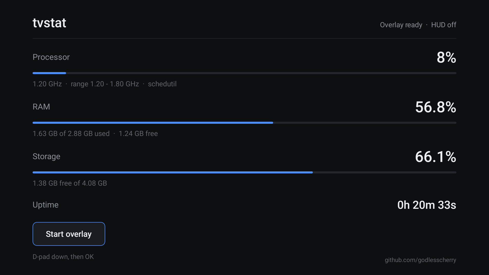
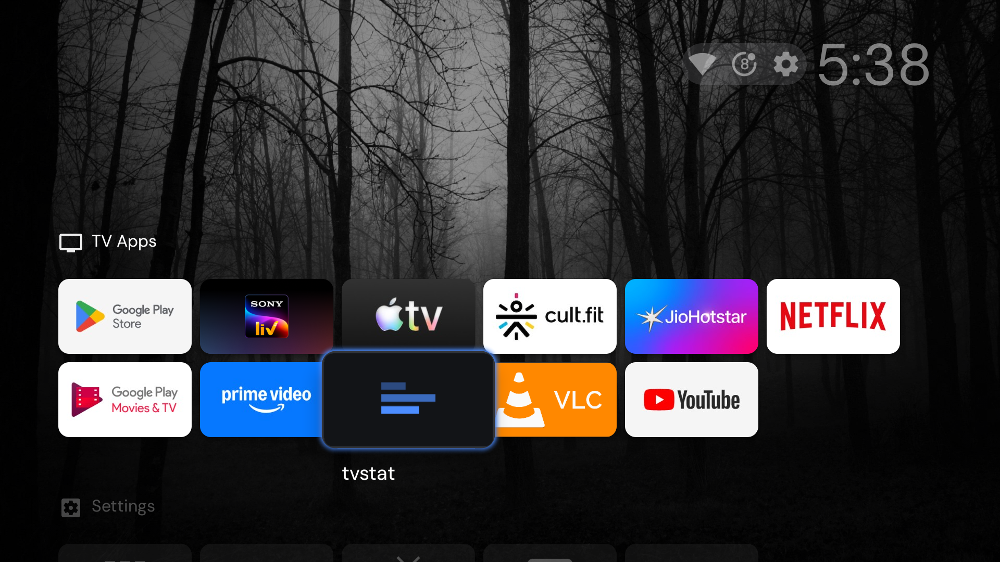

# tvstat

A tiny, dependency-free activity monitor for Android TV. Shows processor load, RAM, storage and
uptime, and can keep a one-row HUD on top of whatever you're watching.

**21 KB. No third-party libraries, no network access, no analytics, no ads.**



## What it shows

| Row | Source |
|---|---|
| **Processor** | time-weighted average core clock from `cpufreq/stats/time_in_state`, normalised against the min-max range |
| **RAM** | `ActivityManager.MemoryInfo` — used, free, total |
| **Storage** | `StatFs` on `/data` — free and total |
| **Uptime** | `SystemClock.elapsedRealtime()` |

Refreshes every second on the dashboard, every two seconds on the HUD. Both stop when not visible.

It installs from an APK like any other app, so it sits on the TV shelf next to your streaming apps:



## The CPU number, and why it's computed the way it is

The obvious source is `/proc/stat`, and on Android it is **blocked for the app domain** — the shell
user can read it over ADB, an ordinary app cannot. `/proc/loadavg` and `/proc/pressure/cpu` are
blocked too, and many TV kernels ship no `cpuidle` nodes.

What *is* readable is `cpufreq/stats/time_in_state`: the kernel's running total of time spent at each
frequency. Diffing those counters gives time-at-frequency for the interval; weighting by frequency
gives the average clock, which is a genuine measure of work rather than a point sample.

That average is normalised against the core's real range:

```
usage% = (avgClock - minClock) / (maxClock - minClock) * 100
```

**The normalisation is the important part.** Many TV SoCs idle at a high floor — the set this was
written for runs 1.20 GHz to 1.80 GHz. The naive `clock / max` therefore reads **67% on a completely
idle TV**. Against the real range, idle reads near zero and pinned cores read 100%.

The bracketed figure on the HUD is the instantaneous clock; the percentage is an interval average, so
the two won't move in lockstep. The percentage is the one to trust.

If `/proc/stat` is readable on your device, the code uses it and shows a true percentage instead.

## HUD

A one-row overlay in the top-left: `CPU 16% (1.20G)   RAM 68%   DISK 65%`. It is
`TYPE_APPLICATION_OVERLAY` with `FLAG_NOT_FOCUSABLE | FLAG_NOT_TOUCHABLE`, so it never takes focus
and never eats a remote press.

It runs in a foreground service, which means Android requires an ongoing notification for it — that
is a platform rule, not a choice.

## Install

```bash
# sideload
adb install --no-incremental tvstat.apk

# grant "display over other apps" without touching the TV's settings UI
adb shell appops set dev.godlesscherry.tvstat SYSTEM_ALERT_WINDOW allow

# open with the HUD already running
adb shell am start -n dev.godlesscherry.tvstat/.MainActivity --ez hud true
```

**Always pass `--no-incremental`.** Without it adb streams the APK from the host and the device keeps
running the previously installed build — which looks exactly like your rebuild did nothing.

On the TV itself: open **tvstat**, D-pad down to the button, press OK to start or stop the overlay.

## Build

No Gradle. The whole build is `aapt2 → javac → d8 → zipalign → apksigner`, in `build.sh`.

Requirements:

- **JDK 17**
- **Android SDK** with `build-tools;34.0.0` and `platforms;android-31`
- `zip`, `jar`, `keytool` (all come with the JDK)

```bash
export ANDROID_SDK_ROOT=/path/to/android-sdk
export JAVA_HOME=/path/to/jdk-17
./build.sh          # -> build/tvstat.apk
```

`build.sh` looks for `./sdk` and `./jdk/Contents/Home` if those variables are unset, and creates a
local debug keystore on first run. **The keystore is gitignored and must never be committed.**

If `sdkmanager` can't reach Google's repository (it happens — the JVM's networking can fail where
`curl` succeeds), fetch the packages directly:

```bash
curl -O https://dl.google.com/android/repository/build-tools_r34-macosx.zip   # note: _macosx, not _mac
curl -O https://dl.google.com/android/repository/platform-31_r01.zip
```

## Layout

```
build.sh                     the entire build, aapt2 through apksigner
app/
├── AndroidManifest.xml       LAUNCHER + LEANBACK_LAUNCHER, overlay + foreground-service permissions
├── res/values/strings.xml
├── res/drawable-xhdpi/banner.png      320x180 TV banner
├── res/mipmap-xhdpi/ic_launcher.png
└── java/dev/godlesscherry/tvstat/
    ├── MainActivity.java     dashboard, watermark, HUD toggle
    ├── BarView.java          drawn progress track (a View, not block characters)
    ├── CpuUsage.java         time_in_state sampler and normalisation
    ├── Metrics.java          RAM / storage / clock readings
    └── MonitorService.java   foreground service + overlay window
```

The UI is built entirely in code — no XML layouts. The icons are PNGs written byte by byte in Python
(no image library required), which is also why they're tiny.

## Compatibility

Written for a Sony BRAVIA on Android 12 (API 31) and tested only there. It should run on any Android
TV 8.0+ (`minSdk 21`), but two things are worth knowing:

- **`foregroundServiceType` is not declared.** Not required on Android 12, but **Android 14+ requires
  it** for a foreground service — add `android:foregroundServiceType` to the service and a matching
  permission before targeting a newer TV.
- **GPU figures are not available** on most TVs: every GPU node on the set this was built for is
  root-only, unreadable even by the ADB shell user.

## Customising

- Colours are `int` constants at the top of `MainActivity.java` (and in `MonitorService.java` for the
  HUD). There is no theme system.
- The watermark is a `TextView` with the handle in `MainActivity.java` — change it or delete the
  `mark` block.
- If you change the launcher icon and your launcher keeps showing the old one, that's an icon cache
  keyed on the package id; bumping `versionCode` may not be enough.

## Licence

MIT — see [LICENSE](LICENSE).
